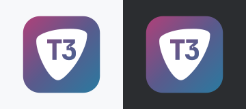
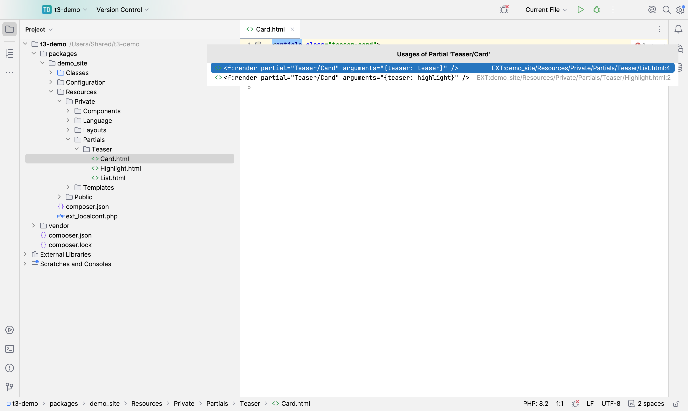

# T3 Toolkit



Plugin ID `app.heckit.ide.t3toolkit` · Vendor heck\it ([heckit.app](https://heckit.app)) · [JetBrains Marketplace](https://plugins.jetbrains.com/plugin/35716-t3-toolkit) · Source: https://github.com/phse/t3-toolkit · Support: [GitHub Sponsors](https://github.com/sponsors/phse) or [Ko-fi](https://ko-fi.com/phse_de) · Feedback and feature requests: [plugin-t3-toolkit@heckit.app](mailto:plugin-t3-toolkit@heckit.app)

Navigation for TYPO3 (v12+) projects in JetBrains IDEs, in both directions: from Fluid templates to partials, layouts,
sections and Fluid Components, from `Services.yaml` to PHP classes - and back to everything that uses them.



## Features

| Where | What |
|---|---|
| Fluid | Cmd/Ctrl-click `partial="…"`, `section="…"`, `<f:layout name="…"/>` (tag and inline syntax). Root paths: `Resources/Private/<Kind>` of the own extension, `*RootPaths` from TypoScript, other extensions. |
| ViewHelpers | Cmd/Ctrl-click `<f:format.html>`, `{f:count()}`, `{x -> my:thing()}` → class; attribute or inline argument → `registerArgument()` (also in parent classes). Namespaces like TYPO3: defaults (`f`, `core`), `ext_localconf.php` (`['SYS']['fluid']['namespaces']`), own list, `{namespace}`/`xmlns` - the last registered wins. |
| Settings | *Languages & Frameworks \| T3 Toolkit* (stored in `.idea/t3toolkit.xml`): auto-detection on/off, additional namespaces `prefix = Ns1, Ns2`. |
| Fluid variables | Cmd/Ctrl-click `{item.title}` → `f:for as`/`iteration`, `f:variable`, `f:alias` in the file; `<fc:param>` in components; `f:render arguments` passing it to a partial; for templates TypoScript `as =`/`variables.` and PHP `assign()`, `assignMultiple()`, `$processedData[]`. |
| Fluid Components | Completion of component tags (`<myCo` → `myComponents:`, `<ns:` → all components of the namespace, required parameters inserted); Cmd/Ctrl-click `<ns:molecule.teaser>` and its attributes; completion of `<fc:param>` parameters; warning for missing required ones; gutter icon and *Navigate \| Related Symbol* to the component files (`.fixture.json`, `Styles`, `Scripts` …); *New \| TYPO3 \| Fluid Component* in a components folder. Namespaces from `ext_localconf.php` (`['fluid_components']['namespaces']`) or by convention `Vendor\Ext\Components`. |
| Fluid errors | Partials, layouts and components that cannot be found are marked as errors (partials/layouts only where the root folders are known). |
| Fluid gutter | Partials, layouts, templates and components list their usages (HTML, TypoScript `EXT:` paths, `templateName`). |
| Any file | `EXT:` paths are clickable. |
| HTML | *Unresolved file reference* is no longer reported for Fluid expressions like `href="{f:uri.typolink(…)}"`. |
| Services.yaml | Cmd/Ctrl-click classes, `@service` references, `resource`/`exclude` paths, tag `method`. |
| Services.yaml quick-fix | *Move to #[…]*: `event.listener` → `#[AsEventListener]` (13.0+), `console.command` → `#[AsCommand]` (12.4.8+, not with `schedulable: false`), `messenger.message_handler` → `#[AsMessageHandler]` (13.0+), `backend.controller` → `#[AsController]` (13.0+) / `#[Controller]` (12.x); `public: true` → `#[Autoconfigure(public: true)]`. Needs `autoconfigure: true`; the entry is removed when `resource` still finds the class. |
| New \| TYPO3 | Event listener (event class with completion), console command, message handler, backend controller, public service and PSR-15 middleware in a PSR-4 folder; Fluid component (with fixture) in a components folder; falls back to a `Services.yaml` entry where the TYPO3 version lacks the attribute, middlewares are added to `Configuration/RequestMiddlewares.php`. |
| PHP gutter | Classes show where and how they are registered: service (public, tags, arguments …), alias, injected into, autodiscovered via `resource`. |

## Installation

[JetBrains Marketplace](https://plugins.jetbrains.com/plugin/35716-t3-toolkit) (*Settings | Plugins*, search "T3 Toolkit") or *Settings | Plugins | ⚙ | Install Plugin from Disk…* with the ZIP from `build/distributions`.

## Build and run

Needs JDK 21+ for Gradle (the toolchain downloads JDK 25).

```
./gradlew buildPlugin        # ZIP in build/distributions
./gradlew test               # fixture tests
./gradlew runIde             # sandbox IDE; -PopenProject=/path/to/typo3-project opens a project
./gradlew verifyPlugin
```

`local.properties` may contain `platformLocalPath=/Applications/PhpStorm.app` to build against an installed IDE.

## Publishing

The Marketplace description lives in `src/main/resources/META-INF/plugin.xml`, the change notes in `build.gradle.kts`,
the icon in `META-INF/pluginIcon.svg` / `pluginIcon_dark.svg` (read by the Marketplace from the ZIP).

1. Raise `pluginVersion` in `gradle.properties`, add the change notes.
2. `./gradlew clean buildPlugin verifyPlugin`
3. `./gradlew publishPlugin` (token as `jetbrainsMarketplaceToken` in `~/.gradle/gradle.properties`
   or `PUBLISH_TOKEN`). The first version has to be uploaded by hand on the Marketplace.
4. Tag the commit (`git tag v<version>`) and push.
5. Screenshots and tags are set by hand on the plugin page (*Edit Plugin*); `publishPlugin` doesn't upload them.

## Regenerating the screenshots

```
./gradlew runIde -Pscreenshots=marketplace/screenshots
```

Copies `marketplace/demo-project` (a small neutral TYPO3 extension) to `/Users/Shared/t3-demo`, so no user path shows
up in the images, opens it in the sandbox and writes the PNGs to `marketplace/screenshots/`. Close a running sandbox
first. The helper lives in `src/screenshot/` and is only compiled with `-Pscreenshots`, never into a release.

## How it works

No own index: extension roots come from `composer.json` (`extension-key`) and `ext_emconf.php`, root paths from
TypoScript files, component namespaces from `ext_localconf.php`; all cached until the next PSI change. Usages are
found via the IDE word index and checked by resolving each hit. `Services.yaml` files are read through the YAML PSI.

## License

Apache License 2.0, see [LICENSE](LICENSE) and [NOTICE](NOTICE).
