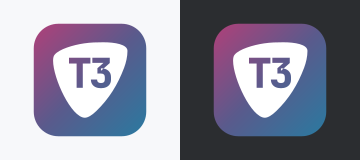
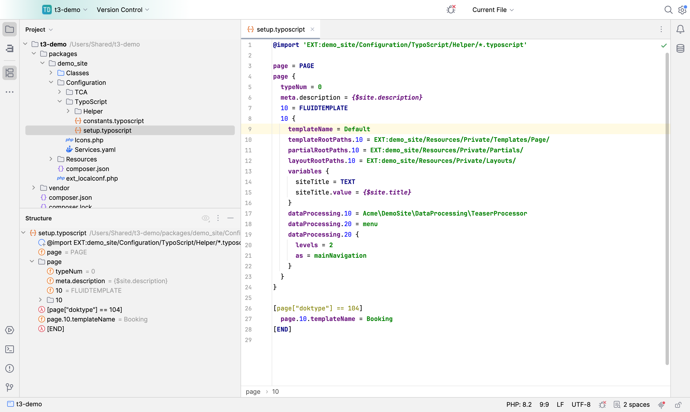

# T3 Toolkit



Plugin ID `app.heckit.ide.t3toolkit` · Vendor heck\it ([heckit.app](https://heckit.app)) · [JetBrains Marketplace](https://plugins.jetbrains.com/plugin/35716-t3-toolkit) · Source: https://github.com/phse/t3-toolkit · Support: [GitHub Sponsors](https://github.com/sponsors/phse) or [Ko-fi](https://ko-fi.com/phse_de) · Feedback and feature requests: [plugin-t3-toolkit@heckit.app](mailto:plugin-t3-toolkit@heckit.app)

TYPO3 (v12+) support for JetBrains IDEs: a TypoScript language (highlighting, completion by object type, navigation,
formatting), Fluid templates and components with inline syntax highlighting and completion, labels (XLIFF), TCA and
`Services.yaml` - navigation in both directions, back to everything that uses a file, label or class.



## Features

| Where | What |
|---|---|
| TypoScript | Own language for `.typoscript`, `.tsconfig`, `setup.txt`/`constants.txt` (TYPO3 v12+ syntax, parsed like the TYPO3 tokenizer): highlighting (*Settings \| Editor \| Color Scheme \| TypoScript*), known properties and numeric keys in their own colours, folding of blocks, multi-line values, comments and condition sections, structure view, breadcrumbs, commenter (`#`, `/* */`), brace matching, formatter (2 spaces like the TYPO3 core, *Code Style \| TypoScript*), *New \| TYPO3 \| TypoScript File*. |
| TypoScript completion | Object paths by type from a built-in reference (`PAGE`, `CONFIG`, `FLUIDTEMPLATE`, `PAGEVIEW`, `stdWrap`, `typolink`, `select`, `imgResource`, `HMENU`, data processors `menu`/`files`/`database-query` …, TSconfig `mod`/`TCEFORM`/`TCEMAIN`/`options`) plus all keys set anywhere in the project; types follow assignments (`= FLUIDTEMPLATE`), copies and references (`< lib.x`) across files. Values: content objects, data processor aliases and classes, known values, booleans; constants after `{$` (constants files and site settings from `settings.definitions.yaml`/`settings.yaml`); functions after `:=`; variables and functions in conditions; `EXT:` paths in values, `@import` and `<INCLUDE_TYPOSCRIPT>`. |
| TypoScript navigation | Cmd/Ctrl-click a path segment → where that object is set (copy sources `<`/`=<` included, relative `.x` too); `{$constant}` → constants file or site setting; `Vendor\Ext\Class->method` (userFunc, dataProcessing) → PHP class or method; data processor alias → class; `@import` with `*` patterns → matching files. Hover: property description and type, content object with its properties, constant values, functions. |
| TypoScript checks | Unclosed blocks (also before a condition), stray `}`, missing operators and `)`; `@import`/`INCLUDE_TYPOSCRIPT` files that don't exist; constants defined nowhere (weak warning); `<INCLUDE_TYPOSCRIPT:` deprecated since v13 with quick-fix *Replace with @import* (folders → `*.typoscript`, `condition` → TypoScript condition). |
| Fluid inline syntax | Highlighting inside `{…}` in text and attributes (*Color Scheme \| Fluid (TYPO3)*): braces, variables, properties, ViewHelpers, argument names, strings, numbers, operators; `{{ vue }}`, `${js}` and JavaScript in `<script>` stay untouched. Completion: `{f:`/`-> f:` → ViewHelpers with required arguments, `f:name(` → arguments, `{` → variables (from `f:for`/`f:variable`/`f:alias`, component parameters, `f:render` arguments of partials, Extbase `assign()`, TypoScript `variables`/`dataProcessing … as`). Hover an inline argument for its documentation. Unknown ViewHelpers (tag and inline) are errors where all classes of the prefix are known. Intentions: inline ↔ tag syntax, HTML comment → `<f:comment>`. |
| Extbase | Gutter icon on `…Action()` methods → `Templates/<Controller>/<Action>.html` (own extension and TypoScript template paths); the template's gutter icon lists the action. |
| TCA | In `Configuration/TCA/*.php`, `Overrides`, `$GLOBALS['TCA'][…]` and `addTCAcolumns()`: completion of keys (table, `ctrl`, columns, `config` by `type`, `types`, `palettes`, items) and values (`type`, `renderType` by type, `format`, `eval`, `l10n_mode`, table names for `foreign_table`/`allowed`, `MM` tables from `ext_tables.sql`, fields for `foreign_field`, `ctrl` fields like `label`/`sortby`, fields, palettes and tabs in `showitem`). Cmd/Ctrl-click these values → TCA file, field, palette or `CREATE TABLE`. |
| Fluid | Cmd/Ctrl-click `partial="…"`, `section="…"`, `<f:layout name="…"/>` (tag and inline syntax). Root paths: `Resources/Private/<Kind>` of the own extension, `*RootPaths` from TypoScript, other extensions. |
| ViewHelpers | Cmd/Ctrl-click `<f:format.html>`, `{f:count()}`, `{x -> my:thing()}` → class; attribute or inline argument → `registerArgument()` (also in parent classes). Namespaces like TYPO3: defaults (`f`, `core`), `ext_localconf.php` (`['SYS']['fluid']['namespaces']`), own list, `{namespace}`/`xmlns` - the last registered wins. |
| ViewHelper completion | Tags (`<f:fo` → `f:format.html`, required arguments inserted) from all subclasses of `AbstractViewHelper` in the prefix's namespaces; arguments from `registerArgument()` (also parents) with type and description; missing required arguments are warnings. Hover a ViewHelper or argument for its DocBlock and argument table. |
| Fluid names | Completion of partial, layout and section names (sections of the partial in the same tag, else of the file). |
| Icons | Cmd/Ctrl-click and completion for `<core:icon identifier="…"/>` from `Configuration/Icons.php` of all extensions. |
| Settings | *Languages & Frameworks \| T3 Toolkit* (stored in `.idea/t3toolkit.xml`): auto-detection on/off, additional namespaces `prefix = Ns1, Ns2`. |
| Fluid variables | Cmd/Ctrl-click `{item.title}` → `f:for as`/`iteration`, `f:variable`, `f:alias` in the file; `<fc:param>` in components; `f:render arguments` passing it to a partial; for templates TypoScript `as =`/`variables.` and PHP `assign()`, `assignMultiple()`, `$processedData[]`. |
| Fluid Components | Completion of component tags (`<myCo` → `myComponents:`, `<ns:` → all components of the namespace, required parameters inserted); Cmd/Ctrl-click `<ns:molecule.teaser>` and its attributes; completion of `<fc:param>` parameters; warning for missing required ones; gutter icon and *Navigate \| Related Symbol* to the component files (`.fixture.json`, `Styles`, `Scripts` …); *New \| TYPO3 \| Fluid Component* in a components folder. Namespaces from `ext_localconf.php` (`['fluid_components']['namespaces']`) or by convention `Vendor\Ext\Components`. |
| Fluid errors | Partials, layouts and components that cannot be found are marked as errors (partials/layouts only where the root folders are known). |
| Fluid gutter | Partials, layouts, templates and components list their usages (HTML, TypoScript `EXT:` paths, `templateName`). |
| Any file | `EXT:` paths are clickable. |
| Labels (XLIFF) | Cmd/Ctrl-click `LLL:EXT:ext/…/locallang.xlf:key` in any file → `<trans-unit>` (path → file); short keys in `<f:translate key="…"/>` / `{f:translate(key: …)}` use `Resources/Private/Language/locallang.xlf` of `extensionName` or of the template's extension (then of all extensions); also any `*:translate` ViewHelper, `LocalizationUtility::translate()` and own calls from the settings (*Additional calls with a label key*, e.g. `MyUtility::label(key, extension)`, `my:label(key)`). Completion of language files after `LLL:` and of keys (with source text) after `.xlf:` and in `f:translate`. Labels are folded and show their text. Missing files and keys are errors (quick-fix *Create label* adds the `<trans-unit>`); in language files, labels missing in or left over in a translation are warnings. Gutter icon on each `<trans-unit>` (also in `de.locallang.xlf` …) with its usages. Hover shows all translations; *Rename* (Shift+F6) on a key or `<trans-unit id>` changes it in every language file and usage. `.xlf` is registered as XML. |
| HTML | *Unresolved file reference* is no longer reported for Fluid expressions like `href="{f:uri.typolink(…)}"`. |
| Services.yaml | Cmd/Ctrl-click classes, `@service` references, `resource`/`exclude` paths, tag `method`. |
| Services.yaml quick-fix | *Move to #[…]*: `event.listener` → `#[AsEventListener]` (13.0+), `console.command` → `#[AsCommand]` (12.4.8+, not with `schedulable: false`), `messenger.message_handler` → `#[AsMessageHandler]` (13.0+), `backend.controller` → `#[AsController]` (13.0+) / `#[Controller]` (12.x); `public: true` → `#[Autoconfigure(public: true)]`. Needs `autoconfigure: true`; the entry is removed when `resource` still finds the class. |
| New \| TYPO3 | Event listener (event class with completion), console command, message handler, backend controller, public service and PSR-15 middleware in a PSR-4 folder; Fluid component (with fixture) in a components folder; falls back to a `Services.yaml` entry where the TYPO3 version lacks the attribute, middlewares are added to `Configuration/RequestMiddlewares.php`. |
| PHP gutter | Classes show where and how they are registered: service (public, tags, arguments …), alias, injected into, autodiscovered via `resource`. |

## Installation

[JetBrains Marketplace](https://plugins.jetbrains.com/plugin/35716-t3-toolkit) (*Settings | Plugins*, search "T3 Toolkit") or *Settings | Plugins | ⚙ | Install Plugin from Disk…* with the ZIP from `build/distributions`.

## Build and run

Needs JDK 21+ for Gradle (the toolchain downloads JDK 25).

```
./gradlew buildPlugin        # ZIP in build/distributions
./gradlew test               # fixture tests
./gradlew runIde             # sandbox IDE; -PopenProject=/path/to/typo3-project opens a project
./gradlew verifyPlugin
```

`local.properties` may contain `platformLocalPath=/Applications/PhpStorm.app` to build against an installed IDE.

## Publishing

The Marketplace description lives in `src/main/resources/META-INF/plugin.xml`, the change notes in `build.gradle.kts`,
the icon in `META-INF/pluginIcon.svg` / `pluginIcon_dark.svg` (read by the Marketplace from the ZIP).

1. Raise `pluginVersion` in `gradle.properties`, add the change notes.
2. `./gradlew clean buildPlugin verifyPlugin`
3. `./gradlew publishPlugin` (token as `jetbrainsMarketplaceToken` in `~/.gradle/gradle.properties`
   or `PUBLISH_TOKEN`). The first version has to be uploaded by hand on the Marketplace.
4. Tag the commit (`git tag v<version>`) and push.
5. Screenshots, tags and the custom page (`marketplace/custom-pages/configuration.md`, without its own H1) are set by hand on the plugin page (*Edit Plugin*); `publishPlugin` doesn't upload them.

## Regenerating the screenshots

```
./gradlew runIde -Pscreenshots=marketplace/screenshots
```

Copies `marketplace/demo-project` (a small neutral TYPO3 extension) to `/Users/Shared/t3-demo`, so no user path shows
up in the images, opens it in the sandbox and writes the PNGs to `marketplace/screenshots/`. Close a running sandbox
first. The helper lives in `src/screenshot/` and is only compiled with `-Pscreenshots`, never into a release.

## How it works

Extension roots come from `composer.json` (`extension-key`) and `ext_emconf.php`, root paths from TypoScript files,
component namespaces from `ext_localconf.php`; all cached until the next PSI change. Usages are found via the IDE word
index and checked by resolving each hit. `Services.yaml` files are read through the YAML PSI.

TypoScript has its own lexer and parser modelled on the TYPO3 v12+ tokenizer (line based; text after `{`, `}`, `>` or a
condition is a comment). One file index (`TypoScriptPaths`) stores every path that is set, with operator and value, per
kind (setup, constants, TSconfig) - completion, types and navigation read it. The property reference is
`src/main/resources/typoscript/tsref.txt` (own compilation). Fluid inline expressions are found by a small scanner
(`FluidInline`) and coloured by an annotator, so other HTML features keep working.

## License

Apache License 2.0, see [LICENSE](LICENSE) and [NOTICE](NOTICE).
